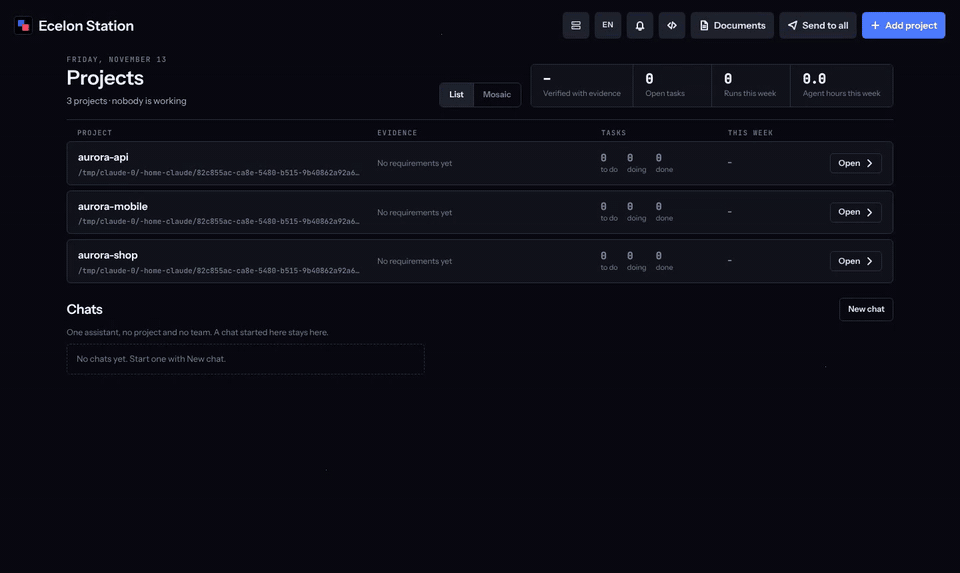
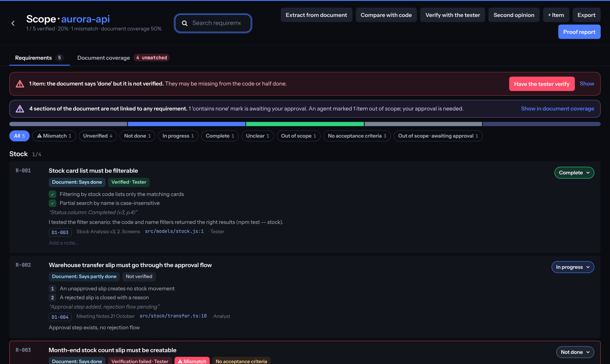
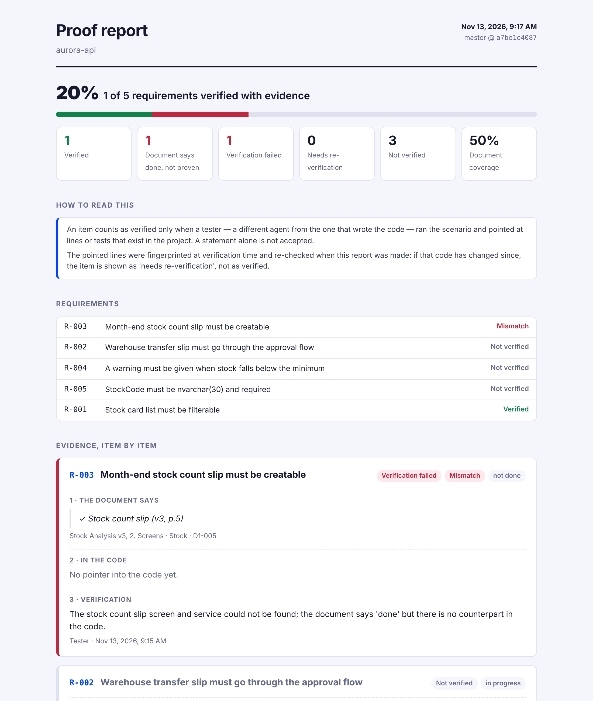
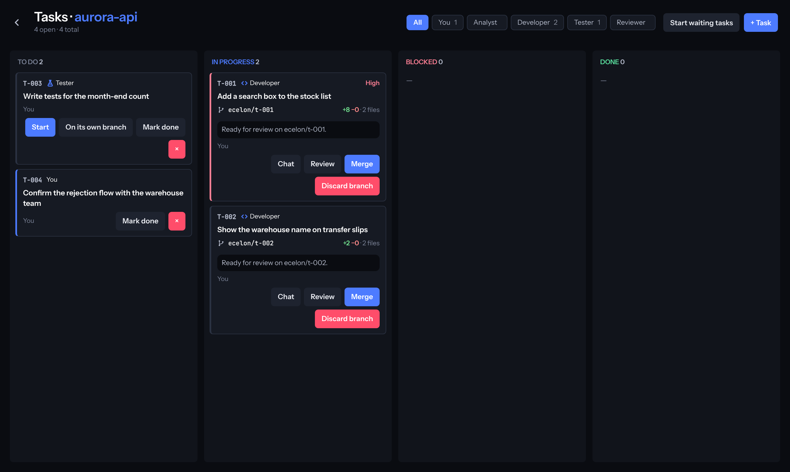
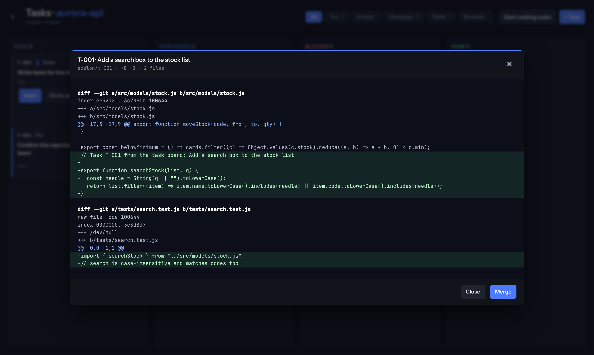
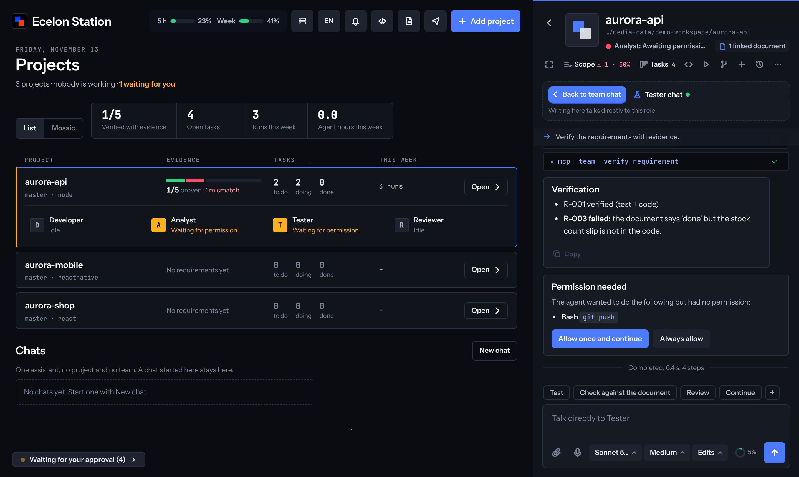
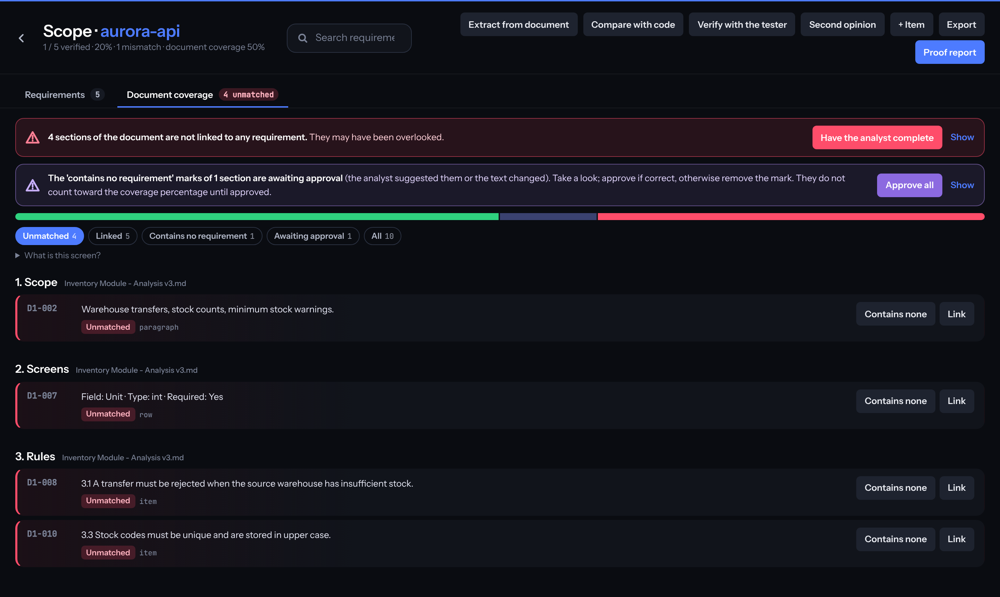
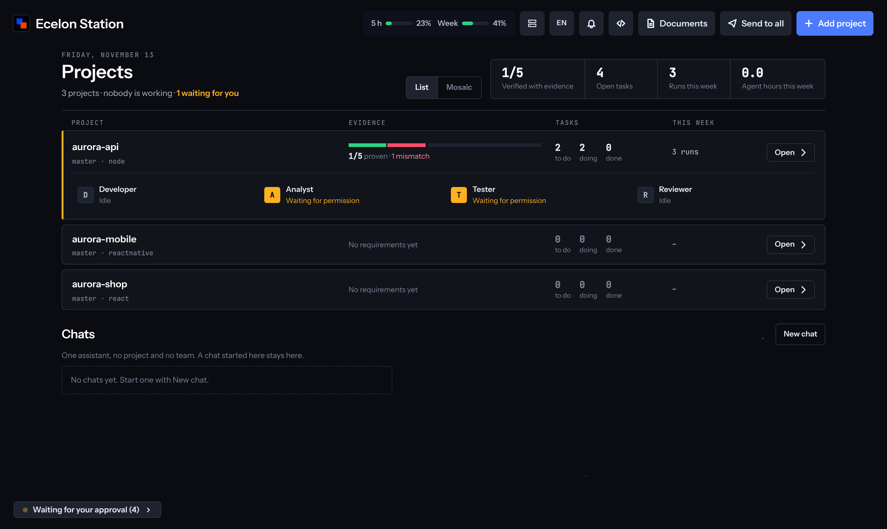
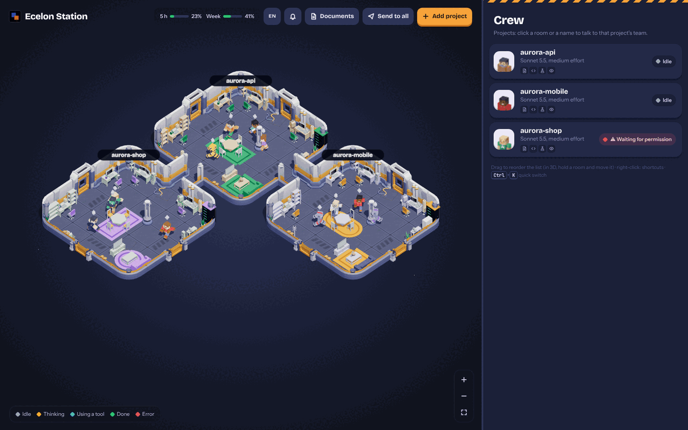

<div align="center">

# Ecelon Station

**Claude Code agents that have to prove their work.**

A local control room for [Claude Code](https://docs.claude.com/en/docs/claude-code) teams. Your spec becomes numbered
requirements, a lead writes the code, and nothing counts as *done* until a **different** agent proves it in the code.
Run several tasks at once, each on its own git branch, and merge what you approve.

[](https://github.com/rildir/ecelon-station/actions/workflows/ci.yml)
[](LICENSE)




[English](README.md) · [Türkçe](README.tr.md)

</div>

## Try it in 30 seconds

No Claude Code, no API key and no project of your own needed: the demo runs scripted agents on three sample projects.

```bash
npx ecelon-station --demo
```

It opens `http://127.0.0.1:4777` and offers to **play the whole loop by itself** (about a minute, you only watch). The
demo keeps its data in a folder of its own, so it never mixes with your real projects.

For real work, install [Claude Code](https://docs.claude.com/en/docs/claude-code) (`claude --version` must work), run
`npx ecelon-station` and press **Add project**. On Windows you can also use the
[desktop app](#desktop-app-windows).

<details><summary>From a clone</summary>

```bash
git clone https://github.com/rildir/ecelon-station
cd ecelon-station
npm install
npm run demo        # or: npm start
```
</details>

## Why

One Claude Code session is easy. Several, across several repos, against a spec that has to be met, is where it breaks:

- The agent says "done". Is it in the code, or did it just *say* so?
- The agent that wrote the code also graded its own homework.
- Two agents in the same folder overwrite each other.
- Your manager asks "how much of the spec is actually built?" and the honest answer is "I'd have to check".

Ecelon Station is built around those four.

## How it is different

Most Claude Code GUIs are about running more agents in parallel. Ecelon Station does that too, and adds the part that
tells you whether the work is real.

| | Ecelon Station | Typical multi-agent GUI |
|---|:---:|:---:|
| Parallel agents, each task on its own git branch | ✓ | ✓ |
| Review the diff, merge or discard from one screen | ✓ | ✓ |
| Spec document → numbered requirements with the spec's own wording | ✓ | — |
| Every requirement checked against the code, with `file:line` | ✓ | — |
| Verified only by a *different* agent, with evidence that really exists | ✓ | — |
| "The document says done but nothing proves it" flagged as a mismatch | ✓ | — |
| One-page proof report for people who were not in the room | ✓ | — |
| Hash-chained audit trail of commands, file writes and permissions | ✓ | — |
| Free, MIT, 100% local, no account | ✓ | varies |

## What you get

### The proof chain
Link an analysis document (Markdown, Word, Excel, PDF) to a project, then:

1. **Extract:** the analyst turns it into numbered requirements (`R-001`…) and quotes the document's own words.
2. **Compare:** it checks each one against the code and points to the `file:line` where it lives, or says it is missing.
3. **Verify:** the *tester*, which did not write the code, runs the scenario and must attach evidence: a command that
   actually ran, lines that actually exist. No evidence, no "verified". If that code changes later, the item drops back
   to "needs re-verification".

Where the document says *done* but nothing verifies it, you get a **mismatch**, not a green tick.

<p align="center"></p>

### A proof report anyone can read
One click turns the chain into a single self-contained page for a manager, a customer or an auditor: for every
requirement, what the document says, where it is in the code, how it was verified, by whom and when. Evidence is
re-checked when the report is made, and the page is stamped with the branch and commit. No scripts; print it or mail it.

<p align="center"></p>

### Parallel tasks on their own branches
Start a task **on its own branch** and it runs in a separate git worktree, so several agents can work on one project
at the same time without touching each other's files or yours. The task board shows what each branch changed; review
the diff, then **Merge** or **Discard**. A conflict is never left half-done in your working copy: the merge is
aborted and the branch is kept for you.

<p align="center"></p>
<p align="center"></p>

### A team per project, not a single chat
Each project gets a **lead**, an **analyst**, a **tester** and a **reviewer**, each with its own session. Only the lead
writes files; the analyst and reviewer read; the tester reports problems instead of quietly "fixing" them. Hand work
over with a button or by typing `@tester`.

<p align="center"></p>

### Document coverage: nothing slips through
Every paragraph, list item, table row and heading of the document is tracked. Sections that no requirement covers are
shown as **unmatched**; an agent can propose "contains no requirement", but that counts only once *you* approve it.
Coverage is computed, not claimed.

<p align="center"></p>

### Two faces
A sober **professional view** (projects, roles, evidence, tasks; no scene, no characters, no sound) for the office,
and a 3D **office view** where every project is a room and every role a character at a desk. One click switches.

<p align="center"> </p>

### The rest
- **Audit trail:** every command, file write and permission (and who allowed it) in an append-only, hash-chained log
  you can filter, check and export as CSV.
- **Safe by default:** a git checkpoint before and after every task; a "3 files changed" card in the chat with diffs
  and one-click undo.
- **A real chat:** model, effort and permission mode, thinking, tool details, plan approval, permission cards, `@file`
  suggestions, message queue, images, usage and context meters. Free chats without a project, too.
- **Document library:** PDF, Word, Excel, Markdown, CSV; search inside documents; version history; undoable deletes.
- **Code editor** (Monaco), **Git panel**, **sibling projects** (the lead warns the other project when it changes a
  shared API), and a **JavaScript / HTML / CSS playground** that runs in a sandbox.
- **English and Turkish**, switch from the top bar.

## Privacy and safety

- The server listens on **`127.0.0.1` only** and checks `Host` and `Origin` (CSRF / DNS-rebinding protection).
- **No telemetry, no accounts, no cloud.** Your code and documents stay on your machine. The only network traffic is
  Claude Code talking to Anthropic, exactly as when you run `claude` yourself.
- Data lives in `./data` from a clone, `~/.ecelon-station` when installed with npm, or wherever `--data` /
  `ECELON_DATA` points. It is git-ignored, so documents never end up in a commit by accident.
- Task branches are worked on in the station's own data folder (`worktrees/`), never inside your project.
- A single-user tool with no login: do not expose its port. Details in [SECURITY.md](SECURITY.md).
- Ecelon Station never pushes, uploads or publishes anything itself. "Full access" mode lets an agent run commands
  without asking; use it only on projects you trust.

## Desktop app (Windows)

The same station in a window of its own: its own taskbar icon, no browser menu or developer tools, and a tray icon that
keeps agents working when the window is closed. Download the installer or the portable exe from
[Releases](https://github.com/rildir/ecelon-station/releases), or run it from a clone with `npm run desktop`.

The exe is not code-signed yet, so Windows SmartScreen warns on first run ("More info" → "Run anyway"). The installed
app keeps its data in `%APPDATA%\Ecelon Station\data`. Dictation is not available in the desktop app. Without WebGL
(some remote desktops and virtual machines) the station still runs, in the professional view.

## Requirements

- Node.js 20+ and a modern browser (WebGL for the office view).
- For real use: [Claude Code](https://docs.claude.com/en/docs/claude-code), signed in. If it is not on your `PATH`,
  point to it with `CLAUDE_BIN=/path/to/claude`.
- Optional: `git` (checkpoints, task branches, Git panel), Python 3.10+ (one-click MarkItDown reader for PDF /
  PowerPoint / EPUB), `zenity` on Linux (folder picker).
- CI runs the tests on Windows, macOS and Linux (Node 20 and 22).

## Options

```
ecelon-station [--demo] [--port 4777] [--lang en|tr] [--data <dir>] [--no-open] [--watch]
```

## Development

```bash
npm install
npm test        # unit tests + a demo-mode smoke test
npm run lint    # eslint + translation consistency check
npm run desktop # the Electron shell, from a clone
```

Plain ES modules, no framework, no bundler. See [CONTRIBUTING.md](CONTRIBUTING.md) and [docs/i18n.md](docs/i18n.md).

## Credits

3D assets by [Kenney](https://kenney.nl) (Space Kit, Furniture Kit, Blocky Characters, CC0). Editor by
[Monaco](https://microsoft.github.io/monaco-editor/), 3D by [three.js](https://threejs.org).

## License

[MIT](LICENSE)
