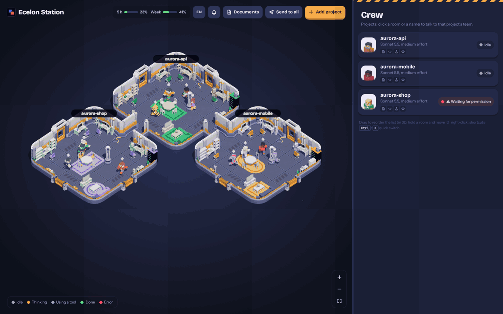
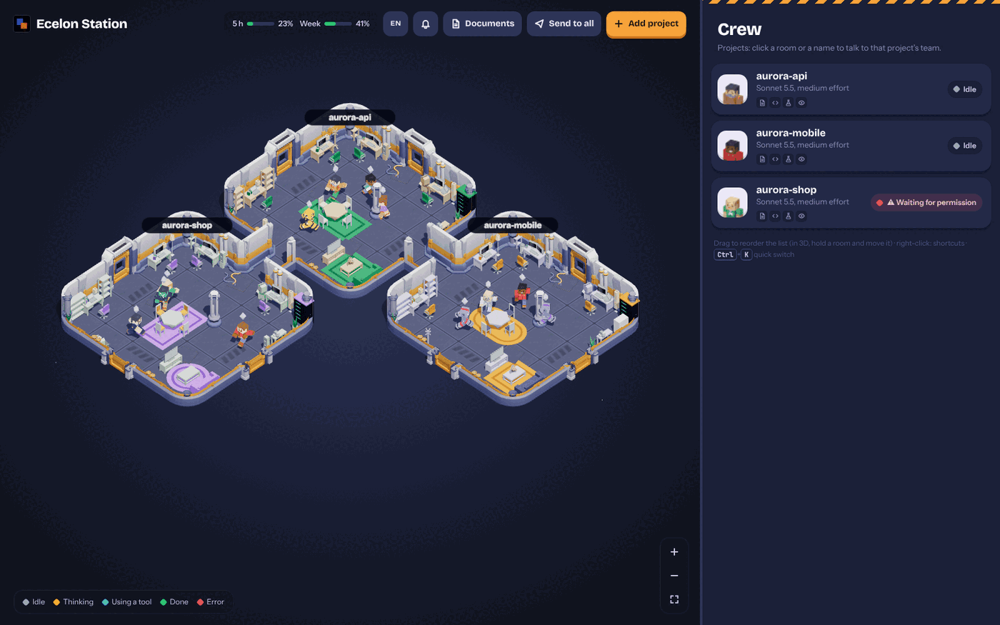
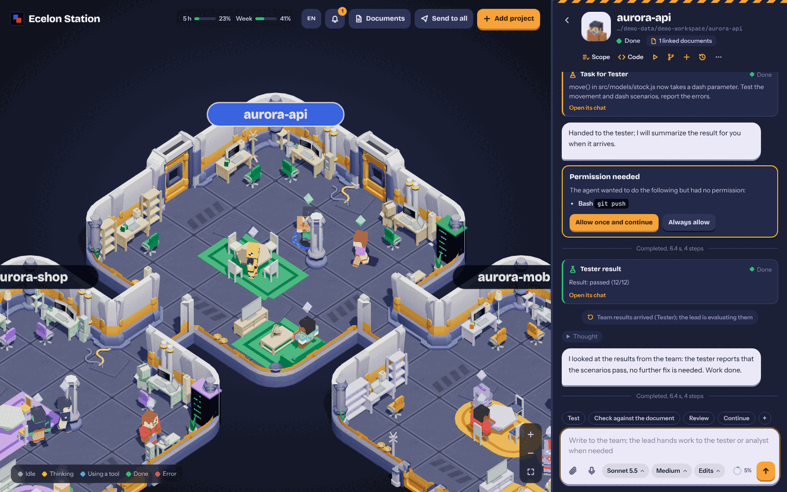
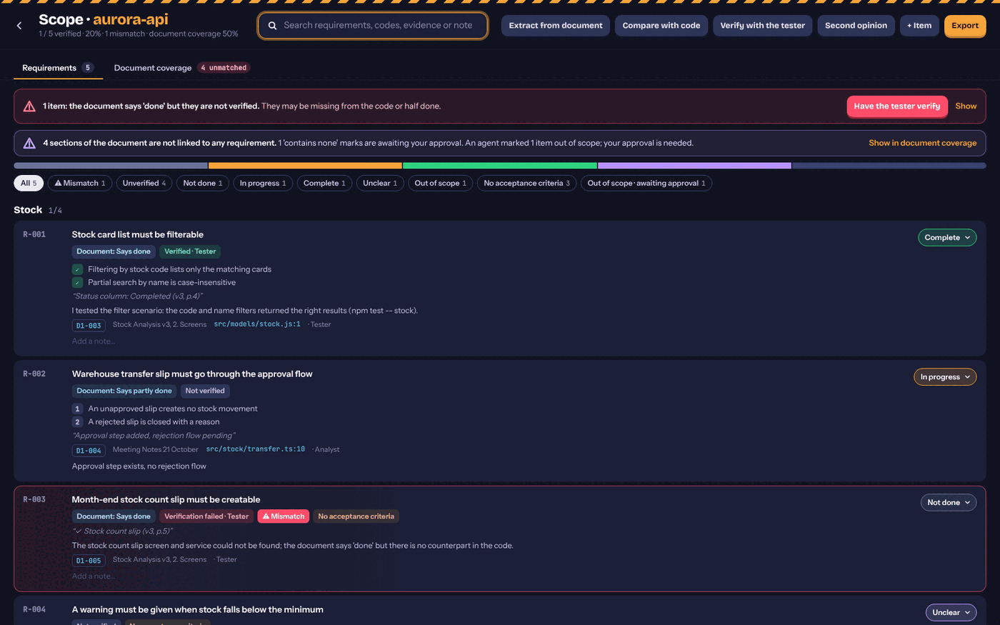
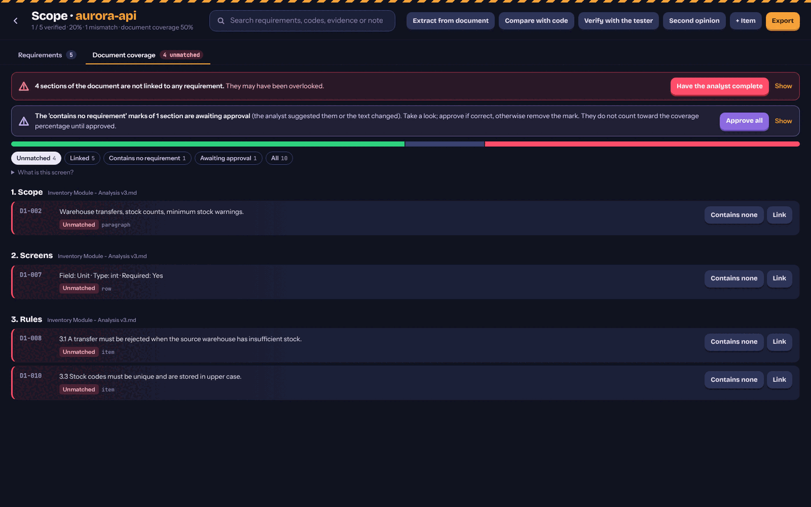

<div align="center">

# Ecelon Station

**A control room for [Claude Code](https://docs.claude.com/en/docs/claude-code) agent teams.**
Every project is a room in an isometric office. Every role is a character at a desk.
And nothing in your spec gets marked "done" unless the code proves it.

[](https://github.com/rildir/ecelon-station/actions/workflows/ci.yml)
[](LICENSE)




[English](README.md) · [Türkçe](README.tr.md)

</div>

## Try it in 30 seconds

No Claude Code, no API key, no project of your own needed — the demo runs scripted fake agents on three sample projects:

```bash
git clone https://github.com/rildir/ecelon-station
cd ecelon-station
npm install
npm run demo
```

It opens `http://127.0.0.1:4777`. Click a room, send a message, then open **Scope** and press **Extract from document → Compare with code → Verify with the tester**.

To drive real agents, install [Claude Code](https://docs.claude.com/en/docs/claude-code) (`claude --version` must work) and run `npm start` instead of `npm run demo`, then **Add project**.

## Why

Running one Claude Code session is easy. Running several, across several repos, with a spec that has to actually be met, is where it gets messy:

- Which of my projects is thinking, waiting for permission, or done?
- The analysis document says "done" for a feature. Is it really in the code, or did somebody just *say* so?
- Did the agent that wrote the code also grade its own homework?

Ecelon Station answers those on one screen.

<p align="center"></p>

## What you get

### A team per project, not a single chat
Each project folder gets a **lead (dev)**, an **analyst**, a **tester** and a **reviewer**, each with its own session and its own desk in the room. Only the lead writes files; the analyst and reviewer are read-only; the tester reports problems instead of quietly "fixing" them. Work is handed over with a button or by typing `@tester` in the message. You can watch it happen in 3D — or ignore the 3D and just use the chat.

<p align="center"></p>

### Spec-vs-reality traceability ("Scope")
Link an analysis document (Markdown, Word, Excel, PDF with MarkItDown) to a project, then:

1. **Extract** — the analyst turns it into numbered requirements (`R-001`…) with the document's own wording as a quote.
2. **Compare** — the analyst checks each one against the code and sets a status with a `file:line` pointer.
3. **Verify** — the *tester* (a different agent) runs the scenario and must attach real evidence (a command that actually ran, a result file). No evidence, no "verified".

Where the document says *done* but nothing verifies it, you get a **mismatch** banner instead of a green tick.

<p align="center"></p>

### Document coverage — nothing slips through
Every paragraph, list item, table row, heading and image of the document is tracked. Sections not linked to any requirement are shown as **unmatched**; an agent can propose "contains no requirement", but that only counts once *you* approve it. Coverage % is computed, not claimed.

<p align="center"></p>

### The rest
- **Safe by default:** a git checkpoint before and after every task (your branch and index are never touched). See a "3 files changed" card with diffs in the chat; undo with one click.
- **Real chat UI:** model / effort / permission mode, thinking stream, tool details, todo list, plan approval, permission cards, `@file` suggestions, message queue, image attachments, voice input, usage and context meters.
- **Document library:** PDF, Word, Excel, Markdown, CSV; search inside documents; automatic version history; deletes are undoable for 7 days. Attach with `#` in the chat.
- **Built-in code editor** (Monaco), Git panel, sibling-project links (the lead warns the other project when it changes a shared API).
- **English and Turkish UI**, switch from the top bar.
- **Quiet:** notifications when a task finishes, needs a permission, or fails.

## Privacy and safety

- The server listens on **`127.0.0.1` only** and checks `Host` and `Origin` (CSRF / DNS-rebinding protection).
- **No telemetry, no accounts, no cloud.** Your code and documents stay on your machine. The only network traffic is Claude Code talking to Anthropic, exactly as when you run `claude` yourself.
- Projects, requirements and the document library are stored in `./data` (or wherever `--data` / `ECELON_DATA` points). They are git-ignored, so documents never end up in a commit by accident.
- Ecelon Station is a single-user tool with no login: do not expose its port (no tunnels, port forwards or shared machines). Details in [SECURITY.md](SECURITY.md).
- Ecelon Station itself never pushes, uploads or publishes anything. In the default permission modes Claude Code asks you before running commands such as `git push`; you answer on a permission card in the chat.
- "Full access" mode lets an agent run commands without asking. Use it only on projects you trust.

## Requirements

- Node.js 20+ and a modern browser with WebGL (Chrome, Edge, Firefox, Safari).
- For real (non-demo) use: [Claude Code](https://docs.claude.com/en/docs/claude-code), signed in. If it is not on your `PATH`, point to it with `CLAUDE_BIN=/path/to/claude`.
- Optional: `git` (checkpoints, change cards, Git panel), Python 3.10+ (for the one-click MarkItDown reader that extracts text from PDF / PowerPoint / EPUB), `zenity` on Linux (folder picker; otherwise paste the path).
- Unit and smoke tests run in CI on Windows, macOS and Linux (Node 20 and 22). Desktop notifications use PowerShell toasts on Windows, `osascript` on macOS and `notify-send` on Linux.
- From a clone on Windows, `windows\install-shortcuts.bat` adds a desktop / Start-menu shortcut that opens the station in its own window and starts the server at login.

## Options

```
node bin/ecelon-station.js [--demo] [--port 4777] [--lang en|tr] [--data <dir>] [--no-open] [--watch]
```

## Development

```bash
npm install
npm test        # unit tests + a demo-mode smoke test
npm run lint    # eslint + translation consistency check
```

Plain ES modules, no framework, no bundler. See [CONTRIBUTING.md](CONTRIBUTING.md) and [docs/i18n.md](docs/i18n.md).

## Credits

3D assets by [Kenney](https://kenney.nl) (Space Kit, Furniture Kit, Blocky Characters — CC0). Editor by [Monaco](https://microsoft.github.io/monaco-editor/), 3D by [three.js](https://threejs.org).

## License

[MIT](LICENSE)
