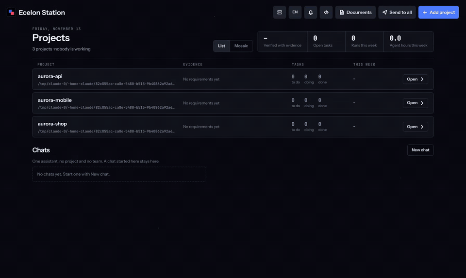
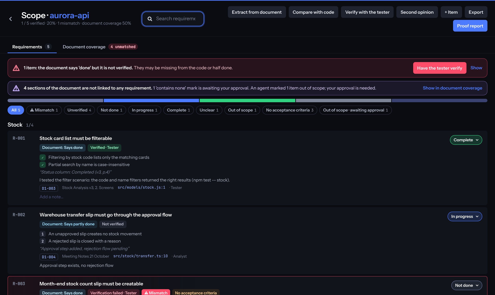
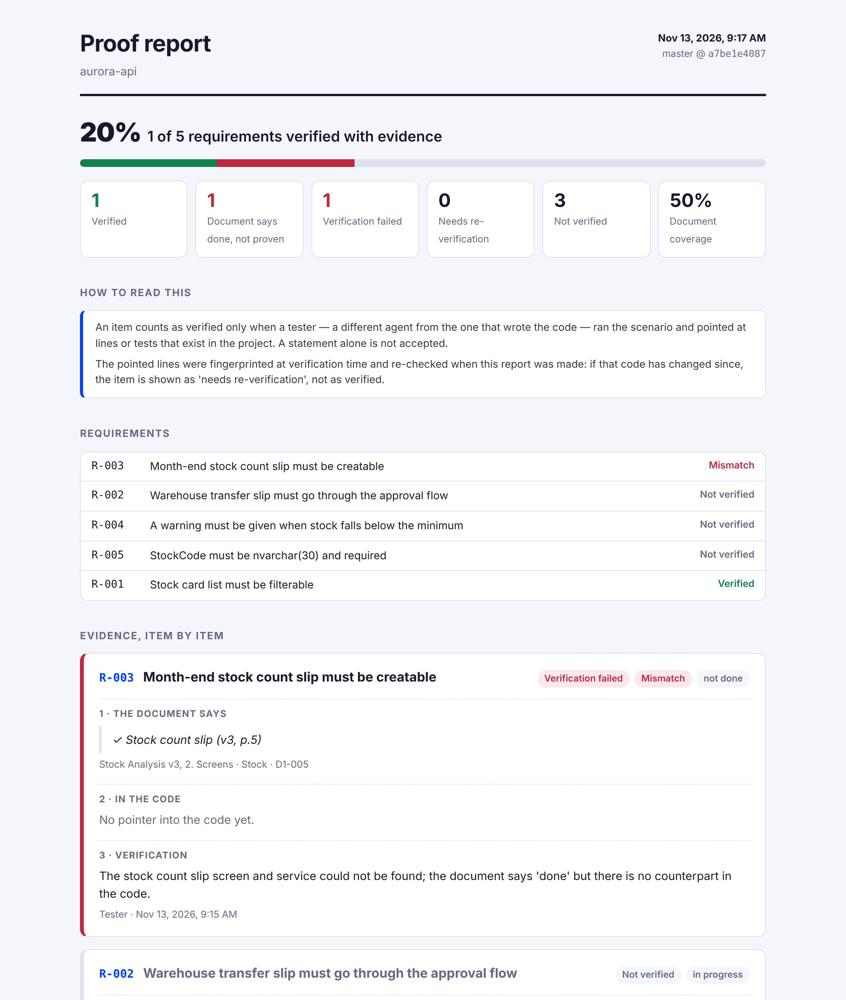
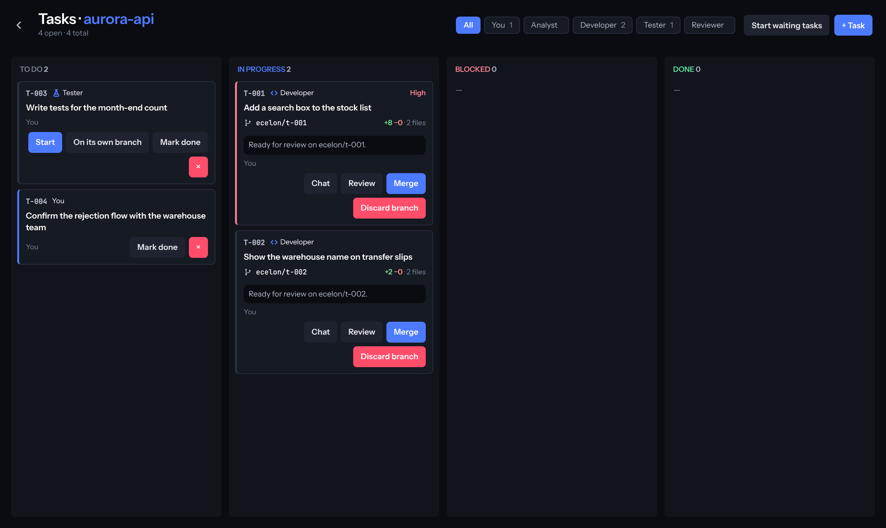
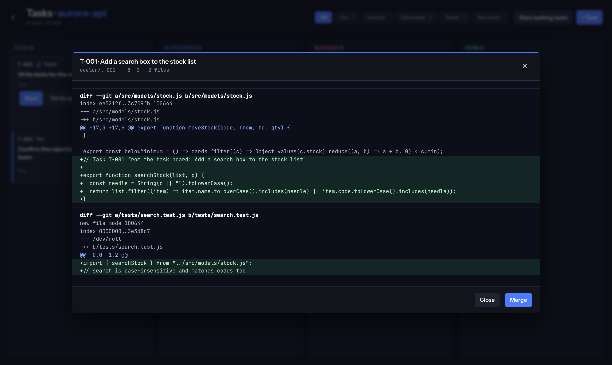
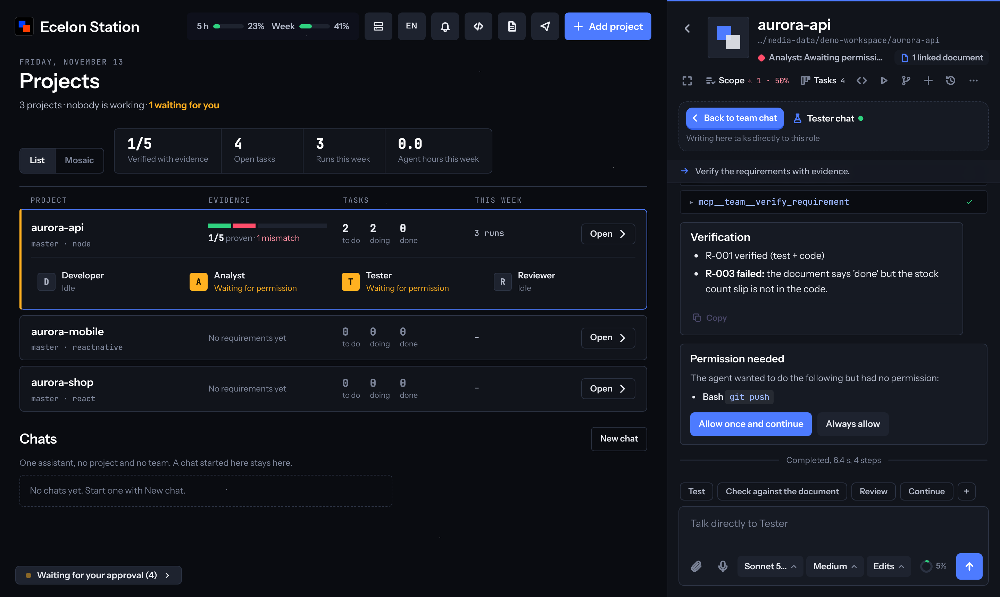
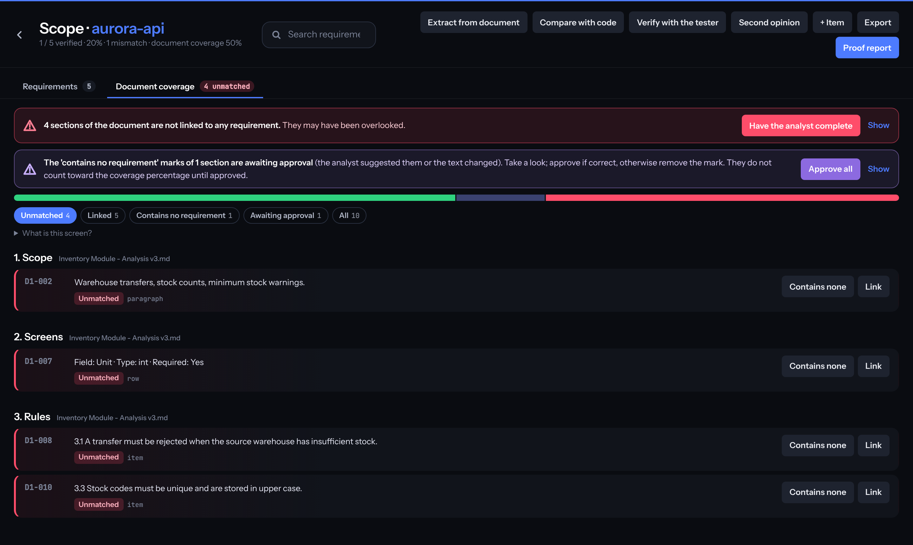
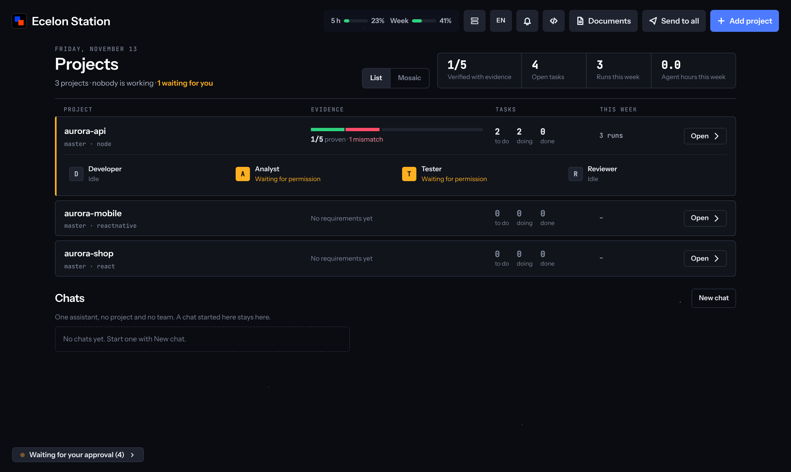
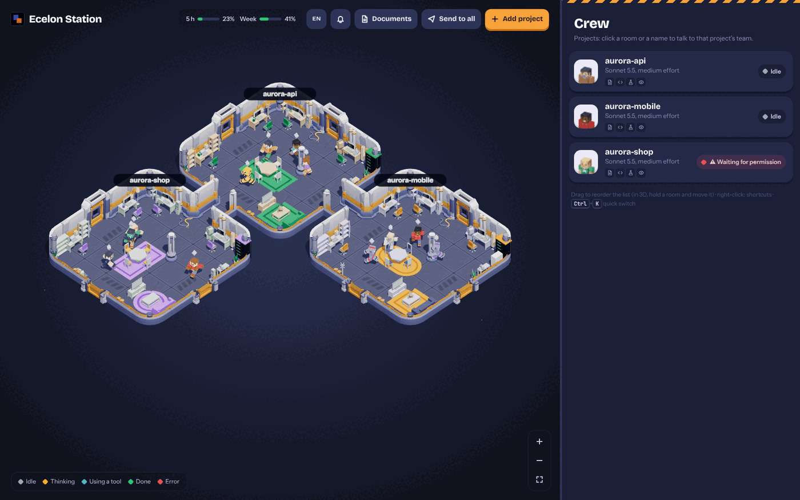

<div align="center">

# Ecelon Station

**İşini kanıtlamak zorunda olan Claude Code ajanları.**

[Claude Code](https://docs.claude.com/en/docs/claude-code) ekipleri için yerel bir kontrol odası. Analiz dokümanın
numaralı gereksinimlere dönüşür, kodu lider yazar ve hiçbir madde, onu yazmayan **başka** bir ajan kodda kanıtlamadan
*yapıldı* sayılmaz. Birden fazla görevi aynı anda, her birini kendi git dalında çalıştır; onayladığını birleştir.

[](https://github.com/rildir/ecelon-station/actions/workflows/ci.yml)
[](LICENSE)




[English](README.md) · [Türkçe](README.tr.md)

</div>

## 30 saniyede dene

Claude Code, API anahtarı ya da kendi projen gerekmez: demo, üç örnek projede senaryolu ajanlar çalıştırır.

```bash
npx ecelon-station --demo
```

`http://127.0.0.1:4777` açılır ve **bütün döngüyü kendi kendine oynatmayı** önerir (yaklaşık bir dakika, sen yalnızca
izlersin). Demo verisini ayrı bir klasörde tutar; gerçek projelerine karışmaz.

Gerçek iş için [Claude Code](https://docs.claude.com/en/docs/claude-code) kur (`claude --version` çalışmalı),
`npx ecelon-station` komutunu çalıştır ve **Proje ekle**'ye bas. Windows'ta
[masaüstü uygulamasını](#masaüstü-uygulaması-windows) da kullanabilirsin.

<details><summary>Klondan</summary>

```bash
git clone https://github.com/rildir/ecelon-station
cd ecelon-station
npm install
npm run demo        # ya da: npm start
```
</details>

## Neden

Tek bir Claude Code oturumu kolay. Birkaç depoda, karşılanması gereken bir analize karşı birden fazlası ise dağılır:

- Ajan "bitti" diyor. Kodda var mı, yoksa sadece *söyledi* mi?
- Kodu yazan ajan kendi ödevini kendisi notluyor.
- Aynı klasörde çalışan iki ajan birbirinin dosyasını eziyor.
- Yöneticin "analizin ne kadarı gerçekten yapıldı?" diye soruyor ve dürüst cevap "bakmam lazım".

Ecelon Station bu dördü üzerine kurulu.

## Farkı ne

Çoğu Claude Code arayüzü daha fazla ajanı paralel çalıştırmakla ilgili. Ecelon Station bunu da yapar ve işin gerçek
olup olmadığını söyleyen kısmı ekler.

| | Ecelon Station | Tipik çoklu ajan arayüzü |
|---|:---:|:---:|
| Paralel ajanlar, her görev kendi git dalında | ✓ | ✓ |
| Farkı incele, tek ekrandan birleştir ya da at | ✓ | ✓ |
| Analiz dokümanı → dokümanın kendi ifadesiyle numaralı gereksinimler | ✓ | — |
| Her gereksinim kodla karşılaştırılır, `dosya:satır` ile | ✓ | — |
| Doğrulamayı yalnızca *başka* bir ajan, gerçekten var olan kanıtla yapar | ✓ | — |
| "Doküman yapıldı diyor ama kanıt yok" uyuşmazlık olarak işaretlenir | ✓ | — |
| Odada olmayanlar için tek sayfalık kanıt raporu | ✓ | — |
| Komut, dosya yazma ve izinlerin hash zincirli denetim kaydı | ✓ | — |
| Ücretsiz, MIT, %100 yerel, hesap yok | ✓ | değişir |

## Neler var

### Kanıt zinciri
Bir analiz dokümanını (Markdown, Word, Excel, PDF) projeye bağla, sonra:

1. **Çıkar:** analist dokümanı numaralı gereksinimlere (`R-001`…) çevirir ve dokümanın kendi sözlerini alıntılar.
2. **Karşılaştır:** her birini kodla karşılaştırır, bulunduğu `dosya:satır`ı gösterir ya da eksik olduğunu söyler.
3. **Doğrula:** kodu yazmamış olan *testçi* senaryoyu çalıştırır ve kanıt eklemek zorundadır: gerçekten çalışmış bir
   komut, gerçekten var olan satırlar. Kanıt yoksa "doğrulandı" da yok. O kod sonradan değişirse madde "yeniden
   doğrulanmalı"ya düşer.

Dokümanın *yapıldı* dediği ama hiçbir şeyin doğrulamadığı yerde yeşil tik değil, **uyuşmazlık** görürsün.

<p align="center"></p>

### Herkesin okuyabileceği kanıt raporu
Tek tıkla zincir; bir yöneticiye, müşteriye ya da denetçiye verilebilecek tek bir sayfaya dönüşür: her gereksinim için
doküman ne diyor, kodda nerede, nasıl, kim tarafından ve ne zaman doğrulandı. Kanıtlar rapor oluşturulurken yeniden
kontrol edilir; sayfaya dal ve commit damgası basılır. Betik yok; yazdır ya da e-postayla gönder.

<p align="center"></p>

### Kendi dalında paralel görevler
Bir görevi **ayrı dalda** başlattığında ayrı bir git worktree'sinde çalışır; böylece birkaç ajan aynı projede aynı anda,
birbirinin ve senin dosyalarına dokunmadan çalışabilir. Görev panosu her dalın neyi değiştirdiğini gösterir; farkı
incele, sonra **Birleştir** ya da **Dalı at**. Çakışma çalışma kopyanda asla yarım bırakılmaz: birleştirme iptal edilir
ve dal senin için saklanır.

<p align="center"></p>
<p align="center"></p>

### Tek sohbet yerine her projede bir ekip
Her projede bir **lider**, bir **analist**, bir **testçi** ve bir **gözden geçirici** vardır; her birinin kendi
oturumu olur. Dosyaları yalnızca lider yazar; analist ve gözden geçirici okur; testçi sorunları sessizce "düzeltmek"
yerine raporlar. İşi bir düğmeyle ya da mesaja `@tester` yazarak devret.

<p align="center"></p>

### Doküman kapsaması: hiçbir şey atlanmaz
Dokümanın her paragrafı, liste maddesi, tablo satırı ve başlığı izlenir. Hiçbir gereksinimin kapsamadığı bölümler
**karşılıksız** görünür; bir ajan "gereksinim içermiyor" önerebilir ama bu ancak *sen* onaylayınca sayılır. Kapsama
iddia edilmez, hesaplanır.

<p align="center"></p>

### İki yüz
Ofis için sade bir **kurumsal görünüm** (projeler, roller, kanıt, görevler; sahne, karakter ve ses yok) ve her projenin
bir oda, her rolün masasında bir karakter olduğu 3D **ofis görünümü**. Tek tıkla geçilir.

<p align="center"> </p>

### Gerisi
- **Denetim kaydı:** her komut, dosya yazma ve izin (ve kimin verdiği) yalnızca eklenebilen, hash zincirli bir kayıtta;
  filtrele, kontrol et, CSV olarak dışa aktar.
- **Varsayılan olarak güvenli:** her görevden önce ve sonra git checkpoint; sohbette farklarıyla "3 dosya değişti"
  kartı ve tek tıkla geri alma.
- **Gerçek bir sohbet:** model, efor ve izin modu, düşünme, araç ayrıntıları, plan onayı, izin kartları, `@dosya`
  önerileri, mesaj kuyruğu, görseller, kullanım ve bağlam göstergeleri. Projesiz serbest sohbetler de var.
- **Belge arşivi:** PDF, Word, Excel, Markdown, CSV; belge içinde arama; sürüm geçmişi; geri alınabilir silme.
- **Kod editörü** (Monaco), **Git paneli**, **kardeş projeler** (lider ortak bir API'yi değiştirince diğer projeyi
  uyarır) ve korumalı ortamda çalışan bir **JavaScript / HTML / CSS Playground**.
- **Türkçe ve İngilizce**, üst çubuktan değiştirilir.

## Gizlilik ve güvenlik

- Sunucu **yalnızca `127.0.0.1`** adresini dinler ve `Host` ile `Origin` başlıklarını kontrol eder (CSRF /
  DNS-rebinding koruması).
- **Telemetri yok, hesap yok, bulut yok.** Kodun ve belgelerin makinende kalır. Tek ağ trafiği, `claude`'u kendin
  çalıştırdığındaki gibi Claude Code'un Anthropic ile konuşmasıdır.
- Veri, klondan çalışırken `./data`, npm ile kurulunca `~/.ecelon-station`, ya da `--data` / `ECELON_DATA` neyi
  gösteriyorsa oradadır. Git tarafından yok sayılır; belgeler yanlışlıkla bir commit'e girmez.
- Görev dalları projenin içinde değil, istasyonun kendi veri klasöründe (`worktrees/`) çalışılır.
- Girişi olmayan, tek kullanıcılı bir araçtır: portunu dışarı açma. Ayrıntılar [SECURITY.md](SECURITY.md) dosyasında.
- Ecelon Station kendi başına hiçbir şeyi push etmez, yüklemez, yayınlamaz. "Tam yetki" modu bir ajanın sormadan komut
  çalıştırmasına izin verir; yalnızca güvendiğin projelerde kullan.

## Masaüstü uygulaması (Windows)

Aynı istasyon, kendi penceresinde: görev çubuğunda kendi ikonu, tarayıcı menüsü ve geliştirici araçları yok, pencere
kapanınca ajanların çalışmaya devam etmesini sağlayan bir tepsi simgesi var. Kurulum dosyasını ya da taşınabilir exe'yi
[Releases](https://github.com/rildir/ecelon-station/releases) sayfasından indir, ya da klondan `npm run desktop` ile
çalıştır.

Exe henüz kod imzalı değil; Windows SmartScreen ilk açılışta uyarır ("Ek bilgi" → "Yine de çalıştır"). Kurulu uygulama
verisini `%APPDATA%\Ecelon Station\data` klasöründe tutar. Masaüstü uygulamasında sesle yazma yok. WebGL olmayan
ortamlarda (bazı uzak masaüstü ve sanal makineler) istasyon kurumsal görünümle çalışır.

## Gereksinimler

- Node.js 20+ ve güncel bir tarayıcı (ofis görünümü için WebGL).
- Gerçek kullanım için: oturum açılmış [Claude Code](https://docs.claude.com/en/docs/claude-code). `PATH`'te değilse
  `CLAUDE_BIN=/yol/claude` ile göster.
- İsteğe bağlı: `git` (checkpoint, görev dalları, Git paneli), Python 3.10+ (PDF / PowerPoint / EPUB için tek tıkla
  MarkItDown okuyucusu), Linux'ta `zenity` (klasör seçici).
- CI testleri Windows, macOS ve Linux'ta (Node 20 ve 22) çalıştırır.

## Seçenekler

```
ecelon-station [--demo] [--port 4777] [--lang en|tr] [--data <klasör>] [--no-open] [--watch]
```

## Geliştirme

```bash
npm install
npm test        # birim testleri + demo modunda duman testi
npm run lint    # eslint + çeviri tutarlılık kontrolü
npm run desktop # klondan Electron kabuğu
```

Düz ES modülleri; framework yok, bundler yok. Bkz. [CONTRIBUTING.md](CONTRIBUTING.md) ve [docs/i18n.md](docs/i18n.md).

## Teşekkür

3D modeller [Kenney](https://kenney.nl) (Space Kit, Furniture Kit, Blocky Characters, CC0). Editör
[Monaco](https://microsoft.github.io/monaco-editor/), 3D [three.js](https://threejs.org).

## Lisans

[MIT](LICENSE)
